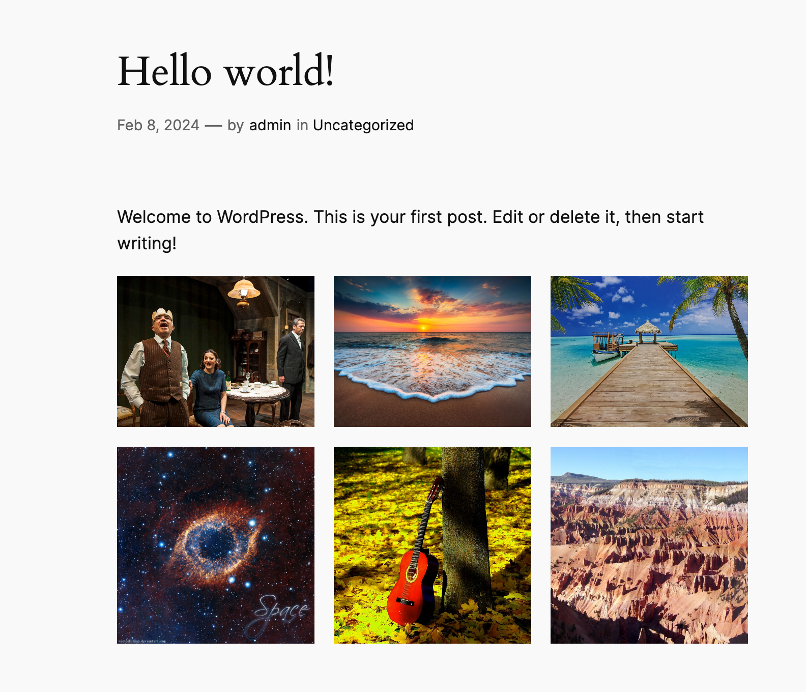

# Test task

Thank you for your attention to this position. Here are two tasks: first about to develop backend, second for frontend.

Login to [wordpress](http://localhost:8080/wp-admin/): `admin` / `1234`

## 1. Backend task

 In the `test task` plugin register [rest endpoint](https://developer.wordpress.org/rest-api/extending-the-rest-api/adding-custom-endpoints/) `GET` [/test-plugin/test-task](http://localhost:8080//wp-json/test-plugin/test-task) to retrieve titles and modified date of last published 6 posts, also there should be boolean `hasMore` key which indicates if there are more posts available:

```
{
  "posts": [
    {
      "title": "test6",
      "modified": "2024-07-05 11:39:50"
    }
    ...
  ],
  "hasMore": true
}
```


## 2. Render specific wordpress post using nextjs. 

There should be a [page](https://nextjs.org/docs/pages/building-your-application/routing/pages-and-layouts), on nextjs part which does GET request `/wp-json/wp/v2/posts/{:id}` to wordpress container, and render json to html. 

You can see the json response example in browser by visiting [the url](http://localhost:8080/wp-json/wp/v2/posts/1) `{:id}` - is an argument that passed through url, so for example if you [open in browser](localhost:3000/post/1): `localhost:3000/post/1` - `1` is the post id, then nextjs should do a request to `test_wp` docker container with path `/wp-json/wp/v2/posts/1`, to get the data, and render it as page. The frontend page should look as much similar as possible to [wp-admin side](http://localhost:8080/hello-world/):




## Valuable moments:
1. Pixel perfect slicing
2. As simple as possible codebase
3. Server side rendering
4. Valid typescript


Good luck!